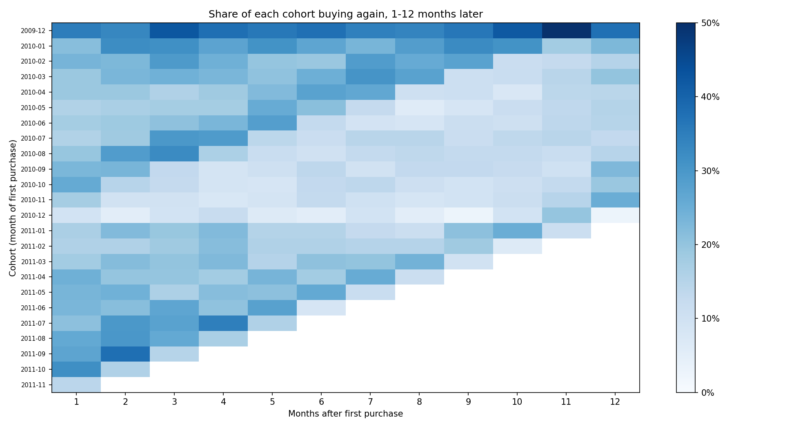
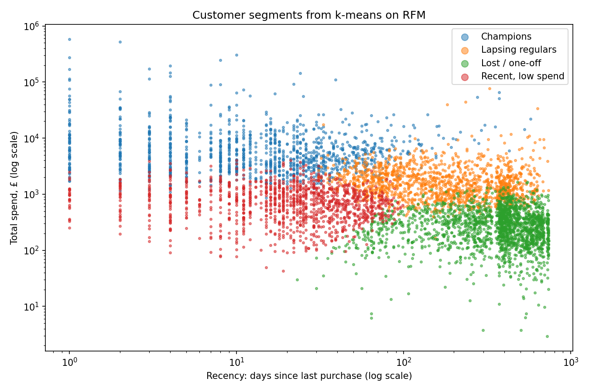
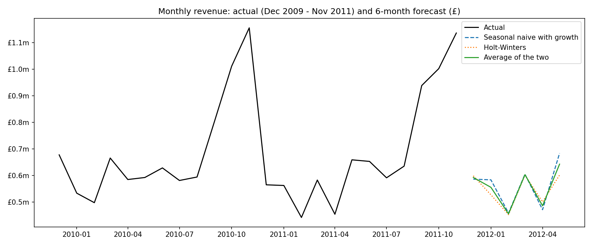
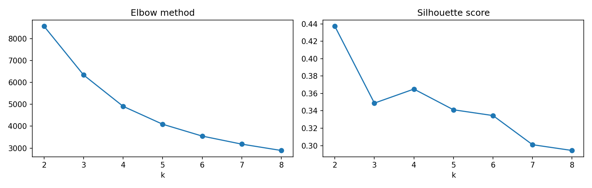

# E-commerce Customer Analytics: SQL, Segmentation, Retention and Forecasting

Who are an online retailer's valuable customers, how many come back, and what will sales be over the next 6 months?

**Author:** Apara Bhargava · BA (Hons.) Economics, Minor in Finance, Ahmedabad University
**Tools:** SQL (SQLite), Python (pandas, scikit-learn, statsmodels, matplotlib), Google Colab

## Data
*Online Retail II*, UCI Machine Learning Repository: about 1 million real transactions from a UK-based online giftware retailer, December 2009 to December 2011 (licence CC BY 4.0).
Chen, D. (2012). *Online Retail II* [Dataset]. https://doi.org/10.24432/C5CG6D

After data-quality checks (missing customer IDs, cancellations, postage and fee lines, zero prices, duplicates): **776,577 sales lines, 5,852 customers, £17.07m revenue.**

## Method
1. **Data quality checks and cleaning**, with an automatic check that every clean line has positive revenue.
2. **SQL:** monthly revenue, orders and order value; top products; countries; repeat vs one-time customers (subquery); return rates and top products net of returns (LEFT JOIN).
3. **Cohort retention:** share of each monthly cohort buying again 1-12 months later; monthly repeat purchase rate.
4. **Customer segmentation:** RFM (recency, frequency, monetary) with **k-means clustering**; number of segments checked with the elbow and silhouette methods.
5. **Customer lifetime value:** actual revenue in each customer's first 12 months.
6. **Forecast:** next 6 months of revenue with a seasonal-naive-with-growth model and Holt-Winters, **backtested** on Jun-Nov 2011.

## Key findings
1. **Repeat customers are the business.** 72% of customers ordered more than once, and they generated **97% of revenue**. One-time buyers (28% of customers) brought just 3%.
2. **Revenue is highly concentrated.** The top 20% of customers produced **77% of revenue**. k-means found a **"Champions"** segment (20% of customers, median 13 orders, last purchase 16 days ago) that alone brought **73% of revenue**.
3. **A quarter of customers are slipping away.** **"Lapsing regulars"** (25% of customers, 17% of revenue) used to order regularly (median 4 orders) but had not bought for a median of 184 days: the obvious target for a win-back campaign.
4. **Retention is stable at about one in five.** On average 21% of a cohort bought again 1 month after their first purchase, and 18% were still buying 12 months later. The monthly repeat purchase rate fell from about 30% of past customers in 2010 to about 18% in 2011, as the base grew with customers who had stopped buying.
5. **Lifetime value:** median 12-month revenue per customer was **£861** (mean £2,306, pulled up by large wholesale buyers); Champions' median was £3,087.
6. **The SQL returns query caught a data problem.** Two top-10 "best sellers" had **95-100% of their sales cancelled**: single bulk orders that were reversed. Ranking products net of returns removes them. Overall, returned value was 4.2% of sales.
7. **Strong year-end seasonality, flat underlying sales.** September-November is the peak (Nov 2011: £1.14m vs about £0.6m in a normal month). Year on year, revenue was flat: £8.33m (Dec 2009 - Nov 2010) vs £8.23m (Dec 2010 - Nov 2011).
8. **Forecast:** about **£3.34m for Dec 2011 - May 2012** (average of two methods). In the backtest the seasonal method was off by **11.7% on average (MAPE)** and under-forecast every month, so the forecast is likely conservative.

| Segment (k-means on RFM) | Share of customers | Share of revenue | Median orders | Median days since last purchase |
|---|---|---|---|---|
| Champions | 20% | 73% | 13 | 16 |
| Lapsing regulars | 25% | 17% | 4 | 184 |
| Recent, low spend | 21% | 6% | 3 | 24 |
| Lost / one-off | 34% | 4% | 1 | 401 |

## Charts
| | |
|---|---|
|  |  |
|  |  |

## Limitations
- One UK retailer selling giftware, mostly to small wholesale buyers, so results are not typical of a consumer beauty brand.
- About a fifth of rows have no customer ID and are excluded from customer analysis.
- No cost or margin data: lifetime value is revenue, not profit.
- Two years of data give only one full seasonal cycle to test against; Holt-Winters could not be backtested.
- k-means needs the number of segments to be chosen; the elbow and silhouette charts guide, but do not decide, that choice.

## How to run
Open `Ecommerce_Customer_Analytics_Final.ipynb` in Google Colab and choose **Runtime → Run all** (the data downloads automatically from UCI).

*Educational project.*
